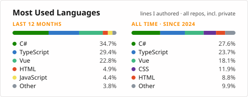

<h1 align="center">Hi, I'm Shwaib Kabore 👋</h1>

  <b>Full-stack developer at <a href="https://gurrensoftware.com">Gurren Software</a></b> 
  C# / .NET · Vue &amp; Nuxt · React &amp; Next.js · Python &amp; Django 
  Ouagadougou, Burkina Faso

I build web products end to end. I started with Python and Django, shipping my first apps on my own, and today I mostly write .NET APIs with Vue/Nuxt or React/Next.js front ends. I'm also finishing a BSc in Software Engineering at New Dawn University, where I lead the IT club.

Curiosity is how I work: when a new idea shows up, I build a small version of it before deciding what I think.

## What I do

- **At Gurren Software:** back end and front end on a delivery platform and a rental marketplace, plus the company website. 130+ merged pull requests so far.
- **Personal research:** AI agents and local LLMs. I design agentic coding workflows (specs, rules, skills) and I'm prototyping a local-first assistant that runs on Ollama.
- **My Django roots:** my first products, built alone: a medicine search engine, a student portal for my school, and a real-estate platform for my second-year capstone.

## Curiosity in practice

- Rebuilt the same API in three architectures in one week, just to feel the trade-offs.
- Let an AI agent write 100% of [StudioLite](https://github.com/Shwaib19/StudioLite), a desktop app, to see where it breaks. Lesson learned: AI works best with specs, tests and a human review.
- I read framework source code, try new APIs in throwaway spikes, and keep a playground of small experiments (Angular, Spring Boot, React Native, Rust).

## Tech

  

- **Daily:** C# / .NET, TypeScript, Vue / Nuxt, React / Next.js, PostgreSQL, Docker, GitHub Actions
- **Also:** Python / Django (DRF), JavaScript, HTML / CSS
- **Exploring:** AI agents and local LLMs (Ollama), Java / Spring Boot, Angular, React Native, Rust

## Stats

  <picture>
    <source media="(prefers-color-scheme: dark)" srcset="https://streak-stats.demolab.com/?user=Shwaib19&amp;theme=dark" />
    
  </picture>
  <picture>
    <source media="(prefers-color-scheme: dark)" srcset="assets/languages-dark.svg" />
    
  </picture>

Languages = lines I wrote in all my repos, company ones included · updated weekly by a <a href=".github/workflows/languages.yml">GitHub Action</a>

## Contact

  
  
  <!-- LinkedIn: add the badge once the profile URL is confirmed -->

